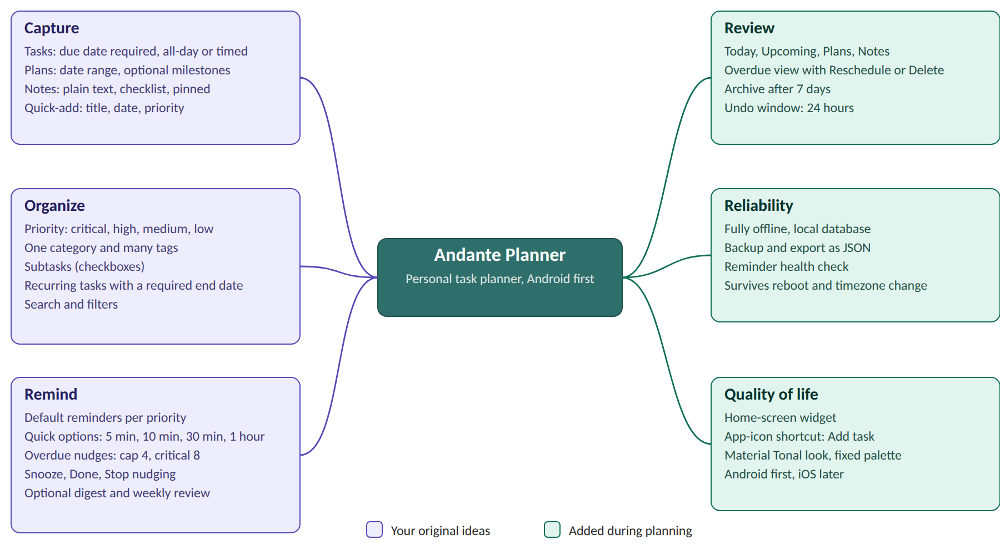
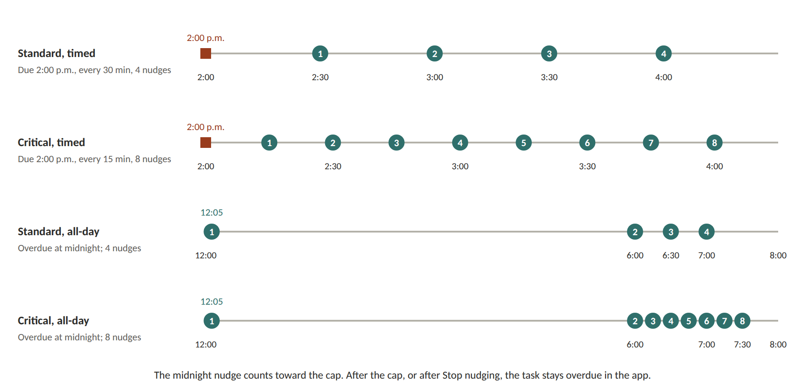
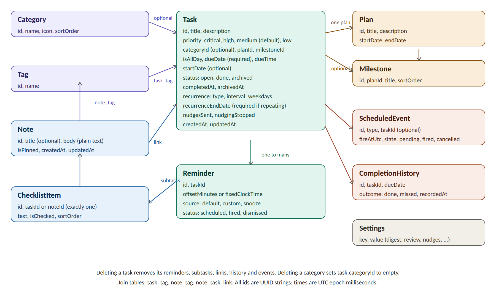
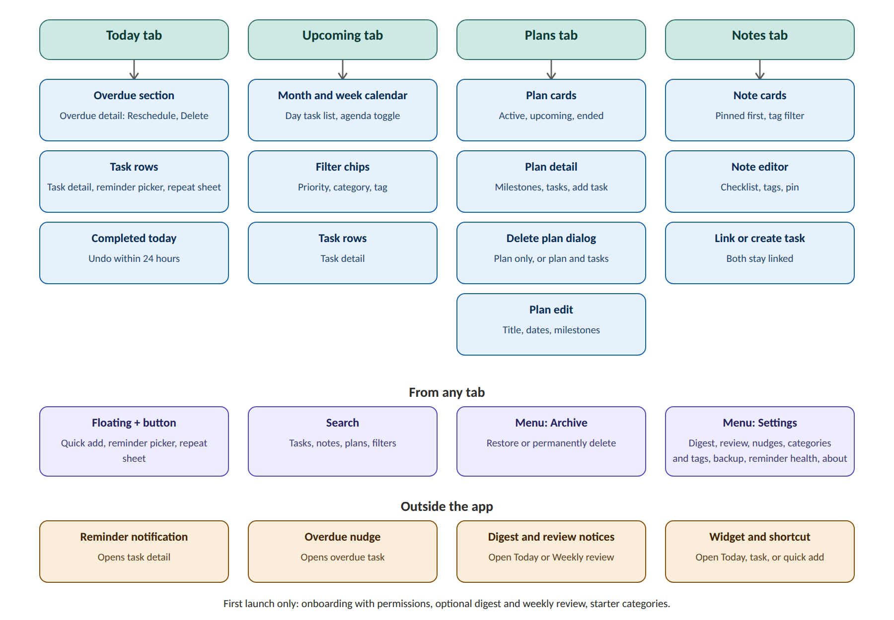
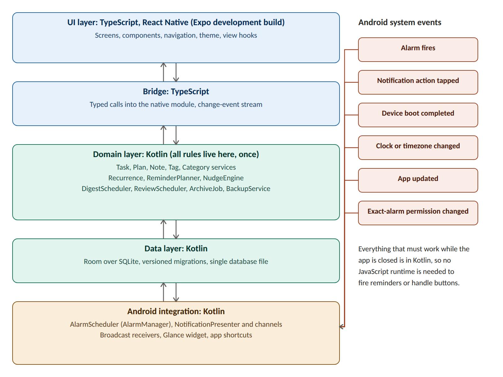
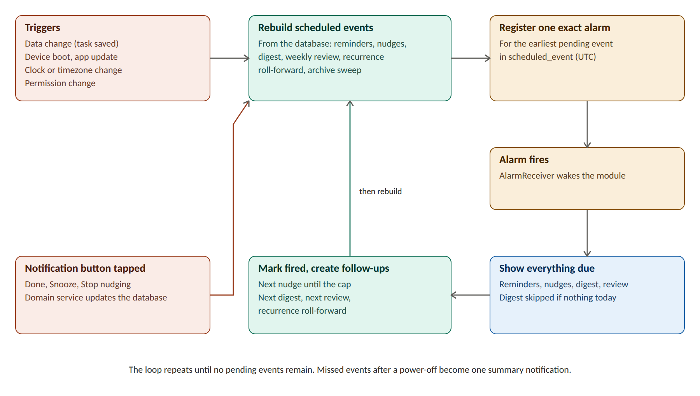

# ANDANTE PLANNER (Specification)

Product Specification and Technical Design

A personal, offline-first task planner for Android, with plans, notes, colour-coded priorities and multi-stage reminders.

| **Item**         | **Detail**                                                                       |
|------------------|----------------------------------------------------------------------------------|
| Document version | 1.0, planning baseline                                                           |
| Date             | 31 October 2026                                                                  |
| Status           | Pre-development. No code written yet.                                            |
| Target platform  | Android first (test phone: Android 16); iOS later                                |
| Stack            | React Native with TypeScript (Expo development build) and a Kotlin native module |
| Visual style     | Material Tonal, fixed Andante palette                                            |
| Distribution     | Personal install (signed APK)                                                    |

## Contents

| **Section**                              | **What it covers**                                                                  |
|------------------------------------------|-------------------------------------------------------------------------------------|
| 1\. Purpose of this document             | How to read and use this specification                                              |
| 2\. Vision, goals and scope              | Goals, success criteria, v1 scope and the scope mind map                            |
| 3\. Decision log                         | Every decision made during planning, with stable IDs                                |
| 4\. Feature specification                | Every v1 feature and its behaviour                                                  |
| 5\. Priority, reminder and nudge rules   | Priority levels, reminders, overdue, nudges, recurrence, digest, review, archive    |
| 6\. Data model                           | Entities, fields, constraints, delete behaviour, time handling                      |
| 7\. Navigation and screen specifications | Navigation map and 23 screens with mockups, plus text-only dialogs                  |
| 8\. Notification catalogue               | Notification types, channels and rules                                              |
| 9\. Technical architecture               | Stack, layers, scheduling engine, recurrence, permissions, widget, layout, building |
| 10\. Visual design specification         | Palette, typography, shape, motion, accessibility                                   |
| 11\. Backup and export format            | The JSON backup file and import rules                                               |
| 12\. Testing strategy                    | Automated tests and on-device checks                                                |
| 13\. Build roadmap                       | Milestones M0 to M7 with exit criteria                                              |
| 14\. Risks and mitigations               | What could go wrong and how it is handled                                           |
| 15\. Deferred features                   | Everything deliberately left out of v1                                              |
| 16\. Assumptions to revisit              | Interpretations to confirm before building                                          |
| 17\. Resolved decisions                  | Decisions settled from the milestone prompts                                        |
| Appendix A to D                          | Glossary, example backup file, worked reminder examples, reliability spike plan     |

*Tip: in Word, open the Navigation pane (View, Navigation Pane) to jump between sections and subsections.*

# 1. Purpose of this document

This document is the single source of truth for Andante Planner, a personal task planner for Android (iOS later). It records every decision made during planning, specifies every feature, screen, rule and data structure, and describes the technical design well enough to start building without further guesswork.

## 1.1 How to read it

- **Sections 2 to 5** explain what the app is, what was decided, and the rules that govern tasks, reminders and nudges.

- **Section 6** defines the data model. **Section 7** specifies every screen with a mockup. **Section 8** specifies notifications.

- **Sections 9 to 11** cover the technical architecture, the visual design and the backup format.

- **Sections 12 to 16** cover testing, the build roadmap, risks, deferred features and assumptions to revisit.

- **Appendices** hold the glossary, an example backup file, worked reminder examples and the reliability spike plan.

## 1.2 Conventions

- "Must" means the behaviour is required in the first Android build (v1). "Should" means strongly intended but can slip without breaking the app. "Later" means deliberately deferred (see Section 15).

- Times are shown as the phone shows them (for example 6:00 a.m.). Dates use the phone's regional format. Weeks start on Sunday.

- Priority names are always written critical, high, medium and low.

- "The user" is the owner of the phone. The app is single-user and has no accounts.

## 1.3 Status

Planning baseline, version 1.0, dated 31 October 2026. No code has been written. The next step after this document is the reliability spike described in Appendix D.

# 2. Vision, goals and scope

## 2.1 Vision

Andante Planner is a calm, dependable place to capture future tasks, longer plans and passing thoughts, and to be reminded at the right moments. "Andante" is a musical tempo meaning at a walking pace: steady and unhurried. The app should feel the same way. It nudges firmly when something important is slipping, and stays quiet otherwise.

## 2.2 Goals

- Capture a task in a few seconds, with a due date, a priority and optional extras.

- Show priority at a glance through colour, never colour alone.

- Deliver reminders on time, with several stages for high-stakes tasks, even after a reboot, a timezone change or the app being closed.

- Keep notes and plans alongside tasks, and let a note and a task point at each other.

- Work fully offline, with no account, no cloud and no security surface to manage.

- Protect the user's data with a simple, dependable backup and export.

### 2.2.1 Success criteria

| **Measure**       | **Target**                                                                                                                                       |
|-------------------|--------------------------------------------------------------------------------------------------------------------------------------------------|
| Reminder accuracy | Every scheduled reminder fires within 60 seconds of its time during a two-week trial that includes reboots, a timezone change and battery saver. |
| Capture speed     | Adding a task through quick-add takes under 5 seconds with title, date and priority.                                                             |
| Data safety       | Export then import on a clean install restores every task, plan, note, tag, category, reminder and setting.                                      |
| Overdue handling  | Overdue nudges follow the caps and timings in Section 5 exactly, verified by automated tests with a fake clock.                                  |
| Offline           | The release build has no internet permission and every feature works in airplane mode.                                                           |

## 2.3 Scope of v1

v1 is the Android build for personal install. It includes everything in Section 4 marked v1. It excludes everything in Section 15.

## 2.4 Mind map

The map below shows the full v1 scope. Purple branches are the original ideas; teal branches were added during planning.



*Figure 1. Andante Planner scope mind map.*

# 3. Decision log

Every decision made during planning, grouped by area. IDs are stable so that other sections can refer to them.

## 3.1 Platform and approach

| **ID** | **Area**      | **Decision**                                                                                                                                       |
|--------|---------------|----------------------------------------------------------------------------------------------------------------------------------------------------|
| D-01   | Platform      | Design for Android and iOS, but build and test Android first. The target test device runs Android 16.                                              |
| D-02   | Compatibility | The app should work across all Android phone brands, which means handling manufacturer battery restrictions.                                       |
| D-03   | Distribution  | Personal install only for now. No app-store release.                                                                                               |
| D-04   | Data location | Fully offline and local. No cloud storage, accounts or authentication.                                                                             |
| D-05   | Backup        | Backup and export are included. Android's built-in backup is left on as an extra safety net.                                                       |
| D-06   | Name          | Andante Planner.                                                                                                                                   |
| D-07   | Framework     | React Native with TypeScript as an Expo development build, plus a local Kotlin native module for the database, scheduling and Android integration. |
| D-08   | Visual style  | Material Tonal with a fixed Andante palette (not wallpaper-based dynamic colour).                                                                  |

## 3.2 Capture

| **ID** | **Area**    | **Decision**                                                                                                                                                                                                        |
|--------|-------------|---------------------------------------------------------------------------------------------------------------------------------------------------------------------------------------------------------------------|
| D-10   | Entry types | Three types: task, plan, note.                                                                                                                                                                                      |
| D-11   | Due dates   | Every task must have a due date. Notes need no date.                                                                                                                                                                |
| D-12   | Timing      | Tasks are all-day or timed. Quick-add defaults to all-day on today's date.                                                                                                                                          |
| D-13   | Notes       | Plain text plus a checklist. Notes can be pinned and tagged. Linking a note to a task keeps both and links them.                                                                                                    |
| D-14   | Plans       | A plan is a container of tasks with a date range and optional milestones. A task belongs to at most one plan. Plans have no start or end reminders. Deleting a plan asks each time whether to delete its tasks too. |
| D-15   | Quick-add   | The quick-add shortcut includes title, date and priority.                                                                                                                                                           |

## 3.3 Organisation

| **ID** | **Area**           | **Decision**                                                                                                                                  |
|--------|--------------------|-----------------------------------------------------------------------------------------------------------------------------------------------|
| D-20   | Priority           | Four levels: critical, high, medium, low. Default is medium.                                                                                  |
| D-21   | Category and tags  | One optional category per task, plus any number of tags. Tags apply to notes too.                                                             |
| D-22   | Deleting labels    | Deleting a category or tag never affects existing tasks or notes.                                                                             |
| D-23   | Subtasks           | Checkboxes only: no own dates, reminders or priority.                                                                                         |
| D-24   | Recurring tasks    | The next occurrence repeats from the due date. A missed occurrence skips to the next future date. Every recurring task must have an end date. |
| D-25   | Starter categories | Personal, School, Errands, Other (all editable).                                                                                              |

## 3.4 Reminders

| **ID** | **Area**          | **Decision**                                                                                                                                                                                 |
|--------|-------------------|----------------------------------------------------------------------------------------------------------------------------------------------------------------------------------------------|
| D-30   | Default schedules | Critical: 1 day, 3 hours and 30 minutes before, plus at due time. High: 1 day and 1 hour before, plus at due time. Medium: 1 hour before, plus at due time. Low: a single alert at due time. |
| D-31   | All-day tasks     | Default reminder at 6:00 a.m. on the due day. Critical all-day tasks also get 8:00 p.m. the day before.                                                                                      |
| D-32   | Setting reminders | The reminder time is set while adding the task, with quick options (5 min, 10 min, 30 min, 1 hour and so on) for any task needing reminders. The picker shows a summary.                     |
| D-33   | Timezone          | Reminders follow the phone's timezone.                                                                                                                                                       |
| D-34   | Snooze            | Default snooze is 10 minutes, adjustable in Settings.                                                                                                                                        |
| D-35   | Morning digest    | Optional. Default time 6:30 a.m., changeable on activation. Counts today's tasks plus overdue ones. Skipped only when both are zero.                                                         |
| D-36   | Weekly review     | Optional. The user chooses the days and time when switching it on.                                                                                                                           |

## 3.5 Overdue nudges

| **ID** | **Area**       | **Decision**                                                                                                                          |
|--------|----------------|---------------------------------------------------------------------------------------------------------------------------------------|
| D-40   | Intervals      | Nudge every 30 minutes; critical tasks every 15 minutes.                                                                              |
| D-41   | Caps           | Stop after 4 nudges; critical tasks stop after 8. (An early mention of "high" was a slip: only critical differs.)                     |
| D-42   | All-day tasks  | Overdue at midnight after the due day. One nudge at 12:05 a.m.; the rest start at 6:00 a.m. The midnight nudge counts toward the cap. |
| D-43   | Timed tasks    | The first nudge comes one interval after the due time.                                                                                |
| D-44   | Stopping       | One action, "Stop nudging", available from the notification. The task stays marked overdue.                                           |
| D-45   | After stopping | The user chooses to delete the task or reschedule it.                                                                                 |
| D-46   | Rescheduling   | Rescheduling regenerates reminders from the priority defaults and resets the nudge count.                                             |

## 3.6 Lifecycle and interface

| **ID** | **Area**            | **Decision**                                                                                             |
|--------|---------------------|----------------------------------------------------------------------------------------------------------|
| D-50   | Auto-archive        | Completed tasks move to the archive after 7 days.                                                        |
| D-51   | Undo                | The undo window after completing a task is 24 hours.                                                     |
| D-52   | Restore             | Archived tasks can be restored at any time.                                                              |
| D-53   | Deletion            | Deletion is permanent. There is no trash.                                                                |
| D-54   | Missed recurrence   | A missed recurring occurrence stays overdue until the next occurrence date, then the task rolls forward. |
| D-60   | Swipe gestures      | Swipe right to complete, swipe left to reschedule. Delete exists only inside the task detail.            |
| D-61   | Formats             | Date and time formats follow the phone settings. The week starts on Sunday.                              |
| D-62   | Navigation          | Bottom navigation with four tabs: Today, Upcoming, Plans, Notes.                                         |
| D-63   | Backup prompt       | A monthly backup prompt is available as an option, off by default.                                       |
| D-64   | Widget and shortcut | A home-screen widget and an app-icon quick-add shortcut are included.                                    |

# 4. Feature specification

The complete feature list. "Behaviour" states what the user sees. Detailed rules are in Section 5, screen layouts in Section 7.

## 4.1 Capture

| **ID** | **Feature**       | **Behaviour**                                                                                                                                                |
|--------|-------------------|--------------------------------------------------------------------------------------------------------------------------------------------------------------|
| F-01   | Add task          | Title, due date (required), all-day or timed, priority (default medium), optional category, tags, plan, milestone, description, subtasks, reminders, repeat. |
| F-02   | Quick add         | Bottom sheet from the "+" button and the app-icon shortcut. Title, date and priority up front; everything else under "More". Defaults to all-day on today.   |
| F-03   | Add plan          | Title, description, start date and end date, with optional milestones.                                                                                       |
| F-04   | Add note          | Optional title, plain-text body, checklist, tags, pin. Autosaves while typing.                                                                               |
| F-05   | Note-to-task link | Link a note to an existing task, or create a task from a note. Both are kept and show each other.                                                            |

## 4.2 Organisation

| **ID** | **Feature**        | **Behaviour**                                                                                                       |
|--------|--------------------|---------------------------------------------------------------------------------------------------------------------|
| F-10   | Priority colours   | Four levels shown by a coloured edge, a ringed checkbox and a label, so priority never depends on colour alone.     |
| F-11   | Category and tags  | One optional category per task; any number of tags on tasks and notes. Manage both in Settings.                     |
| F-12   | Subtasks           | Checkbox items inside a task, with a progress count on the task row.                                                |
| F-13   | Recurring tasks    | Daily, weekly (chosen weekdays), monthly or custom interval, repeating from the due date, with a required end date. |
| F-14   | Milestones         | Optional groupings inside a plan. Tasks may belong to a milestone or sit under "No milestone".                      |
| F-15   | Search and filters | One search across tasks, notes, plans and tags, with filters for priority, category, tag, date range and status.    |

## 4.3 Reminders and notifications

| **ID** | **Feature**             | **Behaviour**                                                                                                                               |
|--------|-------------------------|---------------------------------------------------------------------------------------------------------------------------------------------|
| F-20   | Default reminders       | Generated from priority when a task is saved (Section 5.2).                                                                                 |
| F-21   | Custom reminders        | Quick options (5 min, 10 min, 30 min, 1 hour, 2 hours, 1 day) or an exact date and time. A summary line shows the count and first reminder. |
| F-22   | Snooze                  | Snooze button on the reminder notification, default 10 minutes.                                                                             |
| F-23   | Overdue nudges          | Repeating nudges after a task becomes overdue, with caps and a Stop nudging button (Section 5.4).                                           |
| F-24   | Morning digest          | Optional daily notification with today's count and overdue count. Skipped if both are zero.                                                 |
| F-25   | Weekly review           | Optional weekly notification that opens the Weekly review screen. Days and time chosen on activation.                                       |
| F-26   | Missed-reminder summary | If the phone was off at a reminder time, one summary notification replaces a flood of late alerts.                                          |
| F-27   | Reminder health         | A screen that checks permissions and battery settings and can send a test reminder.                                                         |

## 4.4 Review and lifecycle

| **ID** | **Feature**       | **Behaviour**                                                                                     |
|--------|-------------------|---------------------------------------------------------------------------------------------------|
| F-30   | Today view        | Overdue, timed, all-day and completed-today sections.                                             |
| F-31   | Upcoming view     | Sunday-first month and week calendar with priority dots and a day list, plus an agenda toggle.    |
| F-32   | Overdue handling  | Overdue tasks stay red until done, rescheduled or deleted.                                        |
| F-33   | Complete and undo | Completing shows an Undo snackbar; undo remains possible for 24 hours from the Completed section. |
| F-34   | Archive           | Completed tasks move to the archive after 7 days. Restore at any time, or delete permanently.     |
| F-35   | Plan progress     | Progress bar and days left on each plan, based on done tasks.                                     |

## 4.5 Reliability, data and polish

| **ID** | **Feature**        | **Behaviour**                                                                                                        |
|--------|--------------------|----------------------------------------------------------------------------------------------------------------------|
| F-40   | Offline storage    | All data in a local database. No network access.                                                                     |
| F-41   | Backup and export  | Export everything to a JSON file through the system file picker; import from such a file after saving a safety copy. |
| F-42   | Backup prompt      | Optional monthly prompt, off by default.                                                                             |
| F-43   | Home-screen widget | Today list with overdue count, complete-in-place and a quick-add button.                                             |
| F-44   | App shortcut       | Long-press the app icon for "Add task".                                                                              |
| F-45   | Onboarding         | First-run permission explanations, optional digest and review, starter categories.                                   |
| F-46   | Theme              | Light and dark, following the system by default, using the fixed Andante palette.                                    |
| F-47   | Accessibility      | TalkBack labels, 48 dp touch targets, scalable text, contrast of at least 4.5 to 1.                                  |

# 5. Priority, reminder and nudge rules

## 5.1 Priority levels

| **Level** | **Colour**      | **Timed task: default reminders**             | **All-day task: default reminders**            | **Nudge interval** | **Nudge cap** |
|-----------|-----------------|-----------------------------------------------|------------------------------------------------|--------------------|---------------|
| Critical  | \#B3261E red    | 1 day, 3 hours and 30 min before; at due time | 8:00 p.m. the day before; 6:00 a.m. on the day | 15 min             | 8             |
| High      | \#C2570C orange | 1 day and 1 hour before; at due time          | 6:00 a.m. on the day                           | 30 min             | 4             |
| Medium    | \#2B63C4 blue   | 1 hour before; at due time                    | 6:00 a.m. on the day                           | 30 min             | 4             |
| Low       | \#3F7A47 green  | At due time                                   | 6:00 a.m. on the day                           | 30 min             | 4             |

Medium is the default when no priority is chosen. High, medium and low all-day tasks get only the 6:00 a.m. reminder; that is an interpretation of decision D-31 to be revisited in Section 16.

## 5.2 How reminders are generated

- When a task is saved, the app creates one reminder for each default of its priority and chosen type (timed or all-day).

- A default whose time has already passed is not scheduled. It appears greyed out in the picker, and the summary counts only active reminders.

- The user may switch any default off, and may add custom reminders on top: quick options (5 min, 10 min, 30 min, 1 hour, 2 hours, 1 day before) or an exact date and time.

- If the priority is changed, default reminders are regenerated for the new priority. Reminders the user added or switched off by hand are kept as they are.

- Timed tasks use offsets from the due time. All-day tasks use fixed clock times on the due day or the day before, in the phone's current timezone.

- Completing, deleting or rescheduling a task cancels its pending reminders and nudges. Rescheduling then regenerates reminders for the new date.

## 5.3 When a task is overdue

- A timed task is overdue the moment its due time passes while it is still open.

- An all-day task is overdue at midnight at the end of its due day.

- Overdue is calculated from the due date and the clock; it is not stored.

- Overdue tasks appear first on Today, in a red tonal container, critical first, then oldest first.

## 5.4 Nudge schedule

| **Task type**                      | **Interval** | **Cap** | **First nudge**   | **Last nudge (example)**                         |
|------------------------------------|--------------|---------|-------------------|--------------------------------------------------|
| Standard timed (high, medium, low) | 30 min       | 4       | Due time + 30 min | Due 2:00 p.m.: 2:30, 3:00, 3:30, 4:00 p.m.       |
| Critical timed                     | 15 min       | 8       | Due time + 15 min | Due 2:00 p.m.: 2:15 through 4:00 p.m.            |
| Standard all-day                   | 30 min       | 4       | 12:05 a.m.        | 12:05, then 6:00, 6:30, 7:00 a.m.                |
| Critical all-day                   | 15 min       | 8       | 12:05 a.m.        | 12:05, then 6:00 to 7:30 a.m. in 15-minute steps |



*Figure 2. Nudge timelines. Numbered markers are nudges; the red square is the due time.*

- Each nudge has two actions: Done and Stop nudging.

- Nudging stops on its own at the cap, when the task is completed, or when the user taps Stop nudging.

- After nudging stops, the task stays marked overdue in the app until the user marks it done, reschedules it or deletes it. No further nudges are sent.

- Nudges are generated one at a time: when a nudge fires, the next is created, until the cap is reached.

## 5.5 Stop nudging, reschedule and delete

- **Stop nudging** is the only nudge-stopping action. It leaves the task open and overdue, and sets a flag so no more nudges are created.

- From the overdue task the user can then **Reschedule** (choose a new date, and all-day or a time) or **Delete** (permanent, with a confirmation).

- Rescheduling resets the nudge counter and the stopped flag, and regenerates reminders from the priority defaults.

## 5.6 Snooze

- The reminder notification has a Snooze button. It creates a one-off reminder after the snooze length (default 10 minutes).

- A snoozed reminder does not count as a nudge and does not change the due date.

## 5.7 Recurring tasks

- A recurring task is one row. Its rule has a type (daily, weekly, monthly, custom interval), an interval, weekdays where relevant, and a required end date.

- The next occurrence is calculated from the due date, not from the completion date.

- When an occurrence is completed, the task advances to the first occurrence that falls after today, and the completed occurrence is written to the completion history.

- Completing a task before its due date still advances to the first occurrence after today; this can skip a candidate date that has not yet arrived.

- Undo for a recurring task reverses only its most recent completion. It restores the due date to that completion's occurrence date, removes the corresponding `done` history row, regenerates reminders and resets nudge counters. If that completion ended the series and archived the task, Undo reopens it (see Section 5.10).

- If an occurrence is missed, the task stays overdue (and nudges up to the cap) until the next occurrence date arrives. Then it rolls forward to the occurrence that has just arrived (the first occurrence on or after today) and the missed occurrence is recorded in the history as missed.

- When no occurrence remains before the end date, completing the task finishes the series and the task is archived like any other completed task.

- Editing a recurring task changes the whole series. Deleting it deletes the whole series.

## 5.8 Morning digest

- Off by default. When switched on, the user can change the time (default 6:30 a.m.).

- At the digest time the app counts tasks due today plus overdue tasks. If both counts are zero the digest is skipped for that day.

- The text states the counts and names the first task of the day, for example "3 tasks today and 1 overdue. First: Call the pharmacist at 3:30 p.m."

## 5.9 Weekly review

- Off by default. On activation the user chooses the days and the time.

- The notification opens the Weekly review screen: counts of completed, missed and overdue tasks, overdue tasks to resolve (Reschedule or Delete), next week by day, and plans ending soon.

## 5.10 Completion, undo and archive

- Completing a task shows an Undo snackbar and moves the task into the Completed today section.

- Undo remains available for 24 hours from the Completed section. After that, completed tasks can still be restored from the archive.

- For a recurring task, Undo applies only to the most recent completion. It reads the latest `done` row in CompletionHistory for that task, restores `dueDate` to the row's occurrence date, deletes the row, regenerates reminders and resets nudge counters. If the completion ended the series and the task was archived, Undo reopens it. No new field is needed.

- A completed task moves to the archive 7 days after completion. Restoring reopens it with its original due date, so it may be overdue; the app then offers to reschedule.

- Permanent deletion has no trash. Every delete is confirmed first.

# 6. Data model

All data lives in one local SQLite database owned by the Kotlin core (Section 9). IDs are UUID strings, which makes backup, import and any future sync safe. Times are stored as UTC epoch milliseconds, except due dates and times, which are stored as local wall-clock values (see 6.5).



*Figure 3. Entity relationship overview. Colours group related areas.*

## 6.1 Entities

### Task

| **Field**            | **Type**          | **Required** | **Notes**                                                                                     |
|----------------------|-------------------|--------------|-----------------------------------------------------------------------------------------------|
| id                   | TEXT (UUID)       | Yes          | Primary key.                                                                                  |
| title                | TEXT              | Yes          | Up to 200 characters.                                                                         |
| description          | TEXT              | No           | Plain text.                                                                                   |
| priority             | TEXT              | Yes          | critical, high, medium, low. Default medium.                                                  |
| categoryId           | TEXT              | No           | References Category. Empty means no category.                                                 |
| planId               | TEXT              | No           | References Plan. A task belongs to at most one plan.                                          |
| milestoneId          | TEXT              | No           | References Milestone. Only allowed when planId is set and the milestone belongs to that plan. |
| isAllDay             | INTEGER (0/1)     | Yes          | All-day tasks have no dueTime.                                                                |
| dueDate              | TEXT (YYYY-MM-DD) | Yes          | Local date. Every task has one.                                                               |
| dueTime              | TEXT (HH:mm)      | If timed     | Local time. Empty for all-day tasks.                                                          |
| startDate            | TEXT (YYYY-MM-DD) | No           | Optional date when work should begin.                                                         |
| status               | TEXT              | Yes          | open, done, archived.                                                                         |
| completedAt          | INTEGER           | No           | UTC epoch ms. Set when marked done.                                                           |
| archivedAt           | INTEGER           | No           | UTC epoch ms. Set when auto-archived.                                                         |
| recurrenceType       | TEXT              | No           | daily, weekly, monthly, custom. Empty means not recurring.                                    |
| recurrenceInterval   | INTEGER           | If recurring | Every N days, weeks or months. Minimum 1.                                                     |
| recurrenceWeekdays   | TEXT              | No           | Comma-separated 0 to 6 (Sunday is 0), for weekly rules.                                       |
| recurrenceEndDate    | TEXT (YYYY-MM-DD) | If recurring | Required for every recurring task.                                                            |
| nudgesSent           | INTEGER           | Yes          | Counter, default 0. Reset on reschedule.                                                      |
| nudgingStopped       | INTEGER (0/1)     | Yes          | Set by Stop nudging, default 0. Reset on reschedule.                                          |
| createdAt, updatedAt | INTEGER           | Yes          | UTC epoch ms.                                                                                 |

### Plan

| **Field**            | **Type**          | **Required** | **Notes**                     |
|----------------------|-------------------|--------------|-------------------------------|
| id                   | TEXT (UUID)       | Yes          | Primary key.                  |
| title                | TEXT              | Yes          |                               |
| description          | TEXT              | No           | Plain text.                   |
| startDate            | TEXT (YYYY-MM-DD) | Yes          |                               |
| endDate              | TEXT (YYYY-MM-DD) | Yes          | Must not be before startDate. |
| createdAt, updatedAt | INTEGER           | Yes          |                               |

A plan's status is calculated, not stored: upcoming (starts in the future), active, or ended (end date passed). Plans have no reminders of their own.

### Milestone

| **Field** | **Type**    | **Required** | **Notes**                                  |
|-----------|-------------|--------------|--------------------------------------------|
| id        | TEXT (UUID) | Yes          |                                            |
| planId    | TEXT        | Yes          | References Plan.                           |
| title     | TEXT        | Yes          |                                            |
| sortOrder | INTEGER     | Yes          | Position within the plan; drag to reorder. |

### Note

| **Field**            | **Type**      | **Required** | **Notes**                                              |
|----------------------|---------------|--------------|--------------------------------------------------------|
| id                   | TEXT (UUID)   | Yes          |                                                        |
| title                | TEXT          | No           | When empty, the list shows the first line of the body. |
| body                 | TEXT          | Yes          | Plain text, may be empty if a checklist exists.        |
| isPinned             | INTEGER (0/1) | Yes          | Pinned notes sort first.                               |
| createdAt, updatedAt | INTEGER       | Yes          | Sorting uses updatedAt.                                |

### ChecklistItem

| **Field** | **Type**      | **Required** | **Notes**                                                                  |
|-----------|---------------|--------------|----------------------------------------------------------------------------|
| id        | TEXT (UUID)   | Yes          |                                                                            |
| taskId    | TEXT          | One of two   | Set for task subtasks.                                                     |
| noteId    | TEXT          | One of two   | Set for note checklist items. Exactly one of taskId or noteId must be set. |
| text      | TEXT          | Yes          |                                                                            |
| isChecked | INTEGER (0/1) | Yes          |                                                                            |
| sortOrder | INTEGER       | Yes          |                                                                            |

### Category and Tag

| **Field**          | **Type** | **Required** | **Notes**                                                        |
|--------------------|----------|--------------|------------------------------------------------------------------|
| Category.id, name  | TEXT     | Yes          | Name is unique, case-insensitive.                                |
| Category.icon      | TEXT     | Yes          | Key of an icon from the app's icon set.                          |
| Category.sortOrder | INTEGER  | Yes          | User-reorderable.                                                |
| Tag.id, name       | TEXT     | Yes          | Name is unique, case-insensitive, stored without the leading \#. |

### Join tables

| **Table**      | **Columns**    | **Notes**                                                  |
|----------------|----------------|------------------------------------------------------------|
| task_tag       | taskId, tagId  | Many-to-many between tasks and tags.                       |
| note_tag       | noteId, tagId  | Many-to-many between notes and tags.                       |
| note_task_link | noteId, taskId | Many-to-many. Linking never merges or deletes either side. |

### Reminder

| **Field**     | **Type**      | **Required**     | **Notes**                                              |
|---------------|---------------|------------------|--------------------------------------------------------|
| id            | TEXT (UUID)   | Yes              |                                                        |
| taskId        | TEXT          | Yes              | References Task.                                       |
| offsetMinutes | INTEGER       | For timed        | Minutes before the due time. 0 means at due time.      |
| fixedTime     | TEXT (HH:mm)  | For all-day      | Clock time, with dayOffset below.                      |
| dayOffset     | INTEGER       | For all-day      | 0 for the due day, -1 for the day before.              |
| absoluteAt    | INTEGER       | For custom exact | UTC epoch ms if the user chose an exact date and time. |
| source        | TEXT          | Yes              | default, custom, snooze.                               |
| enabled       | INTEGER (0/1) | Yes              | The user can switch default reminders off.             |
| status        | TEXT          | Yes              | scheduled, fired, dismissed.                           |

### ScheduledEvent

| **Field** | **Type**    | **Required** | **Notes**                                                                                         |
|-----------|-------------|--------------|---------------------------------------------------------------------------------------------------|
| id        | TEXT (UUID) | Yes          |                                                                                                   |
| type      | TEXT        | Yes          | reminder, nudge, midnight_overdue, digest, review, recurrence_roll, archive_sweep, backup_prompt. |
| taskId    | TEXT        | No           | Set for task-related events.                                                                      |
| refId     | TEXT        | No           | For example the reminder id behind a reminder event.                                              |
| fireAtUtc | INTEGER     | Yes          | UTC epoch ms, calculated from local values and the current timezone.                              |
| state     | TEXT        | Yes          | pending, fired, cancelled.                                                                        |

This table is derived data. It can be deleted and rebuilt from the other tables at any time, which is how reboots, clock changes and timezone changes are handled.

### CompletionHistory

| **Field**  | **Type**          | **Required** | **Notes**                            |
|------------|-------------------|--------------|--------------------------------------|
| id         | TEXT (UUID)       | Yes          |                                      |
| taskId     | TEXT              | Yes          |                                      |
| dueDate    | TEXT (YYYY-MM-DD) | Yes          | The occurrence this record is about. |
| outcome    | TEXT              | Yes          | done or missed.                      |
| recordedAt | INTEGER           | Yes          | UTC epoch ms.                        |

### Settings

| **Key**                                       | **Default**         | **Notes**                                       |
|-----------------------------------------------|---------------------|-------------------------------------------------|
| allDayReminderTime                            | 06:00               | Clock time for all-day reminders.               |
| snoozeMinutes                                 | 10                  | Snooze length.                                  |
| nudgeIntervalStandard / nudgeIntervalCritical | 30 / 15             | Minutes between nudges.                         |
| nudgeCapStandard / nudgeCapCritical           | 4 / 8               | Maximum nudges per overdue task.                |
| digestEnabled / digestTime                    | false / 06:30       | Time is set on activation.                      |
| reviewEnabled / reviewDays / reviewTime       | false / none / none | Set on activation. Days are 0 (Sunday) to 6.    |
| autoArchiveDays                               | 7                   | Days after completion.                          |
| undoWindowHours                               | 24                  |                                                 |
| theme                                         | system              | system, light, dark.                            |
| backupPromptEnabled / lastBackupAt            | false / none        | Monthly prompt and the time of the last export. |
| schemaVersion                                 | current             | Used by migrations and by backup import.        |

## 6.2 Constraints and validation

- A task must have a title and a due date. A timed task must have a due time.

- A recurring task must have an interval of at least 1 and an end date that is not before its due date.

- A milestone can only be assigned to a task whose planId matches the milestone's plan. Removing a task from a plan also clears its milestone.

- A task's due date outside its plan's date range is allowed, with a warning.

- A plan's end date must not be before its start date.

- Category names and tag names are unique, ignoring case.

- A checklist item has exactly one parent: a task or a note.

## 6.3 Delete behaviour

| **Deleting**   | **What happens**                                                                                                                                               |
|----------------|----------------------------------------------------------------------------------------------------------------------------------------------------------------|
| Task           | Its reminders, subtasks, tag links, note links, completion history and scheduled events are deleted. The linked notes stay.                                    |
| Note           | Its checklist, tag links and task links are deleted. The linked tasks stay.                                                                                    |
| Plan           | The user is asked each time: delete the plan only (its tasks stay as standalone tasks, with plan and milestone cleared), or delete the plan and all its tasks. |
| Milestone      | Its tasks stay in the plan with the milestone cleared.                                                                                                         |
| Category       | Tasks keep existing; their category becomes empty.                                                                                                             |
| Tag            | Only the links to the tag are removed. Tasks and notes keep existing.                                                                                          |
| Archived tasks | Deleted one at a time, or all at once from Settings, always with confirmation.                                                                                 |

## 6.4 Indexes

- Task: (status, dueDate), (planId), (categoryId).

- ScheduledEvent: (state, fireAtUtc).

- Reminder: (taskId). ChecklistItem: (taskId), (noteId). Join tables on both columns.

## 6.5 Time handling

- Due dates and times are stored as local wall-clock values: "all-day on 24 October" and "3:30 p.m. on 24 October" mean the same wall-clock moment wherever the phone is.

- When scheduling, the core turns local values into UTC fire times using the phone's current timezone. Reminders therefore follow the phone, as decided (D-33).

- When the phone's timezone or clock changes, the scheduled events are rebuilt from the local values.

- Display formats (12 or 24 hour, date order) come from the phone's regional settings. Weeks start on Sunday.

## 6.6 Migrations

- The schema carries a version number. Every change ships a migration, tested with a database from the previous version.

- The backup file carries the same schema version so older backups can be imported after the schema changes.

# 7. Navigation and screen specifications

Every screen of v1, with a mockup in the Andante look. Mockups use sample data and are illustrative; the written specification beside each one is authoritative.

## 7.1 Navigation map

Four tabs sit in a bottom navigation bar. A floating "+" button opens quick add from the three task-oriented tabs (Today, Upcoming, Plans) and creates a note on the Notes tab. Search, Archive and Settings are reached from the top bar and menu.



*Figure 4. Navigation map, including entry points from outside the app.*

## 7.2 Shared components

- **Task row:** a 4 dp priority-coloured edge, a ringed checkbox in the same colour, the title, and a meta line (time or "All day", category, up to two tags then "+N", subtask progress, plan name) with small icons for repeating and linked notes.

- **Top bar:** screen title, optional subtitle (counts or dates), and icons for search and menu where relevant.

- **Floating "+" button:** primary container colour, 52 dp, above the bottom bar.

- **Bottom sheets:** 24 dp rounded top corners, a drag handle, a title, content and a primary action.

- **Snackbar:** appears after completing a task with "Undo", and after destructive-but-undoable actions.

- **Empty states:** one calm sentence and a clear next action, never an illustration-heavy screen.

- **Swipe gestures on task rows:** right to complete, left to reschedule (quick picks: tomorrow, next Sunday, choose a date). Delete is never a swipe.

## 7.3 Screen specifications

### 7.3.1 Onboarding (first run)

*Mockup image: `docs/mockups/onboarding.png` (illustrative; the text below is authoritative).*

**Purpose**

- Explain and request the permissions reminders depend on, and set optional features.

**Elements**

- Step 1: welcome. Step 2: three permission cards (notifications, exact alarms, battery), each with a plain-language reason and an Allow button. Step 3: optional digest and weekly review switches. Step 4: starter categories.

- Progress dots and a Next button.

**Behaviour**

- Each Allow opens the matching system prompt or settings page. The user may skip a step; the Reminder health screen shows anything skipped.

- Digest and weekly review switches open the same setup sheets as Settings (Section 7.3.18).

- Starter categories Personal, School, Errands, Other are created; they can be edited later.


### 7.3.2 Today

*Mockup image: `docs/mockups/today.png` (illustrative; the text below is authoritative).*

**Purpose**

- The daily command centre: what is overdue, what is due today and what is done.

**Elements**

- Top bar: full date, subtitle "N tasks, N overdue", search and menu icons.

- Overdue section in a red tonal container with a count, ordered critical first, then oldest first.

- Timed section sorted by time, then All day section sorted by priority.

- Completed today section, collapsed by default, showing 24-hour undo.

- Floating "+" and bottom navigation (Today selected).

**Behaviour**

- Tapping a checkbox completes the task, shows an Undo snackbar and moves it into Completed today.

- Tapping a row opens task detail. Swipe right completes; swipe left opens reschedule quick picks.

- If Reminder health finds a problem, a warning banner appears above the sections.

- Empty state: "Nothing due today", with a button to add a task.


### 7.3.3 Quick add

*Mockup image: `docs/mockups/quickadd.png` (illustrative; the text below is authoritative).*

**Purpose**

- Capture a task in seconds. Opened by the "+" button, the app-icon shortcut and the widget.

**Elements**

- Title field, focused immediately. Chips for date and time (default "Today, all day") and category.

- Priority selector with four options (default medium).

- Reminders block with the summary line and chips; an Add button opens the picker.

- List rows for Tags, Plan and Repeat; a Save task button.

**Behaviour**

- Defaults: all-day on today, medium priority, default reminders for that priority.

- Changing priority updates default reminders unless the user has already edited the list.

- Save is disabled until the title is filled. Repeat requires an end date before saving.


### 7.3.4 Reminder picker

*Mockup image: `docs/mockups/reminderpicker.png` (illustrative; the text below is authoritative).*

**Purpose**

- Review, switch off and add reminders for a task. Shown here for a timed medium task.

**Elements**

- Summary line: count and the first reminder, for example "3 reminders, first at 2:30 p.m.".

- List of default reminders with switches, then custom reminders with a remove button.

- Quick options: 5 min, 10 min, 30 min, 1 hour, 2 hours, 1 day, and Custom for an exact date and time.

**Behaviour**

- Defaults whose time has already passed are greyed out and not scheduled; the quick options help set a sensible short-notice reminder.

- For all-day tasks the picker offers "On the day, 6:00 a.m." (default), "Day before, 8:00 p.m." and a custom time instead of minute offsets.

- No limit on the number of reminders.


### 7.3.5 Repeat sheet

*Mockup image: `docs/mockups/repeat.png` (illustrative; the text below is authoritative).*

**Purpose**

- Make a task recur. Every recurring task needs an end date.

**Elements**

- Type selector: Daily, Weekly, Monthly, Custom. Interval ("Every 1 week") and weekday circles for weekly rules (Sunday first).

- End date field marked required, with an error state until chosen.

- Preview of the next three occurrences.

**Behaviour**

- Occurrences are calculated from the due date. A missed occurrence skips to the next future date.

- Done stays disabled until an end date is chosen. The end date cannot be before the due date.


### 7.3.6 Task detail

*Mockup image: `docs/mockups/taskdetail.png` (illustrative; the text below is authoritative).*

**Purpose**

- See and edit everything about one task.

**Elements**

- Title, priority pill, then detail rows: due date and time (or all-day), category, tags, reminders (count and times), repeat summary.

- Plan and milestone, description, subtasks with progress, linked notes.

- For recurring tasks, a history of completed and missed occurrences.

- Mark done button; menu with Edit and Delete.

**Behaviour**

- Editing a recurring task changes the whole series.

- Subtasks are checkboxes only; ticking them does not complete the task automatically.

- Delete asks for confirmation and is permanent. For a recurring task it deletes the whole series.


### 7.3.7 Overdue task

*Mockup image: `docs/mockups/overdue.png` (illustrative; the text below is authoritative).*

**Purpose**

- Resolve a task that is overdue, especially after nudging has stopped.

**Elements**

- Red banner: "Overdue since 2:00 p.m." with the status "Nudging stopped" and the nudge count, for example "3 of 8 nudges were sent".

- Three actions: Mark done, Reschedule, Delete.

**Behaviour**

- Reschedule opens a sheet for a new date and all-day or time. It regenerates reminders from the priority defaults and resets the nudge count.

- Delete is permanent, with a confirmation.

- While nudging is still active, the banner shows a Stop nudging button as well.


### 7.3.8 Upcoming

*Mockup image: `docs/mockups/upcoming.png` (illustrative; the text below is authoritative).*

**Purpose**

- See the shape of the coming weeks and the tasks on any day.

**Elements**

- Month header and a Sunday-first calendar that collapses to a week strip. Each day shows up to three dots coloured by priority, with the highest priority first.

- Filter chips for priority, category and tag. An agenda toggle shows the next 14 days grouped by date.

- The selected day's tasks in the standard row style.

**Behaviour**

- Plan date ranges appear as a small label on affected days (for example "Exam prep, day 3 of 10"), not as a separate calendar layer.

- Overdue tasks are not shown here; they live on Today.


### 7.3.9 Plans list

*Mockup image: `docs/mockups/plans.png` (illustrative; the text below is authoritative).*

**Purpose**

- Overview of all plans and their progress.

**Elements**

- Three groups: Active, Upcoming (start date in the future), Ended (end date passed).

- Each card: title, date range, days left, progress bar, and "N of N tasks done".

**Behaviour**

- Tapping a card opens the plan detail. The "+" button creates a plan (title, description, start date, end date, optional milestones).


### 7.3.10 Plan detail

*Mockup image: `docs/mockups/plandetail.png` (illustrative; the text below is authoritative).*

**Purpose**

- Work through a plan, organised by milestone.

**Elements**

- Header with date range, progress bar and description.

- Collapsible milestone sections with their tasks and a count; a "No milestone" section for the rest.

- Add task button that pre-fills the plan (and the milestone when added inside one). Menu with Edit and Delete.

**Behaviour**

- Milestones are reordered by dragging.

- A task whose due date falls outside the plan's range is allowed with a warning.

- Deleting a plan opens the dialog in Section 7.3.11.


### 7.3.11 Delete plan dialog

*Mockup image: `docs/mockups/deleteplan.png` (illustrative; the text below is authoritative).*

**Purpose**

- Make deleting a plan a deliberate choice about its tasks, each time.

**Elements**

- Title with the plan name, the number of tasks in the plan, and a note that deleting cannot be undone.

- Three buttons: Delete plan only, Delete plan and N tasks, Cancel.

**Behaviour**

- Delete plan only keeps the tasks as standalone tasks with plan and milestone cleared.

- Delete plan and tasks removes the tasks with all their reminders and nudges.


### 7.3.12 Notes list

*Mockup image: `docs/mockups/notes.png` (illustrative; the text below is authoritative).*

**Purpose**

- Browse thoughts and reference notes.

**Elements**

- Tag filter chips (All plus one per tag). Pinned section first, then Other sorted by last edited.

- Each card: title or first line, body preview, tags, checklist progress, count of linked tasks.

**Behaviour**

- The "+" button opens the note editor directly. Search is available from the top bar.


### 7.3.13 Note editor

*Mockup image: `docs/mockups/noteedit.png` (illustrative; the text below is authoritative).*

**Purpose**

- Write, check off, tag and link a note.

**Elements**

- Optional title, plain-text body, checklist section, tags, pin toggle and delete in the top bar.

- Linked tasks section with "Link a task" (choose an existing task) and "Create task" (pre-filled from the note).

**Behaviour**

- Autosaves while typing; there is no Save button.

- Creating a task from a note keeps the note and links the two. Either side can be opened from the other.

- Delete is permanent, with a confirmation. Linked tasks stay.


### 7.3.14 Search and filters

*Mockup image: `docs/mockups/search.png` (illustrative; the text below is authoritative).*

**Purpose**

- Find anything quickly.

**Elements**

- Search field with a clear button; filter chips for priority, category, tag, date and status (open, done, archived).

- Results grouped as Tasks, Notes and Plans, each with a count.

**Behaviour**

- Searches titles, descriptions, subtask text, note bodies, checklist text and tags.

- A group with no matches shows a short "No plans match." line.


### 7.3.15 Archive

*Mockup image: `docs/mockups/archive.png` (illustrative; the text below is authoritative).*

**Purpose**

- Hold completed tasks older than a week.

**Elements**

- Search icon, month groups, struck-through task rows with the completion date and a restore icon.

- Delete all archived at the bottom, in the danger colour.

**Behaviour**

- Restore reopens the task with its original due date and offers to reschedule if it is overdue.

- Deleting one task or all archived tasks is permanent and confirmed.


### 7.3.16 Settings

*Mockup image: `docs/mockups/settings.png` (illustrative; the text below is authoritative).*

**Purpose**

- Configure behaviour in one place.

**Elements**

- Appearance (light, dark, follow system). Reminders (all-day time 6:00 a.m., snooze length, read-only default schedules).

- Overdue nudges (intervals and caps, stored values). Morning digest and Weekly review switches with their times.

- Tasks (auto-archive 7 days, undo window 24 hours). Categories and tags. Backup and export. Reminder health with a status line. About.

**Behaviour**

- Switching the digest or weekly review on opens its setup sheet; switching off cancels the pending notifications.


### 7.3.17 Categories and tags

*Mockup image: `docs/mockups/categories.png` (illustrative; the text below is authoritative).*

**Purpose**

- Manage the labels used on tasks and notes.

**Elements**

- Categories (one per task): name, icon, drag handle to reorder, add category.

- Tags (any number): chips; tapping a tag offers Rename and Delete.

**Behaviour**

- Deleting a category or tag never deletes tasks or notes. Task categories become empty; tag links are removed.

- Names are unique, ignoring case. Renaming to an existing name is refused with a message.


### 7.3.18 Weekly review setup

*Mockup image: `docs/mockups/reviewsetup.png` (illustrative; the text below is authoritative).*

**Purpose**

- Switch on the weekly review and choose when it arrives. The morning digest has a similar sheet with just a time.

**Elements**

- Day circles (Sunday first, multi-select), a time field, Cancel and Turn on.

**Behaviour**

- Turn on is disabled until at least one day and a time are chosen. The digest sheet defaults to 6:30 a.m.


### 7.3.19 Weekly review

*Mockup image: `docs/mockups/review.png` (illustrative; the text below is authoritative).*

**Purpose**

- A short guided look back and ahead.

**Elements**

- Three counts: completed, missed, overdue now, for the week just ended.

- Overdue to resolve, each with Reschedule and Delete.

- Next week by day, with task counts. Plans ending soon.

- Finish review button.

**Behaviour**

- Opened from the weekly review notification or from Settings.


### 7.3.20 Backup and export

*Mockup image: `docs/mockups/backup.png` (illustrative; the text below is authoritative).*

**Purpose**

- Protect data that lives only on this phone.

**Elements**

- Last backup status, Export backup, Import backup, and the optional monthly backup prompt switch.

**Behaviour**

- Export opens the system file picker with a suggested name such as andante-backup-2026-10-23.json.

- Import validates the file, shows a summary of its contents, saves a safety copy of the current data, then replaces the current data after confirmation. Reminders are rebuilt afterwards.

- The monthly prompt is a notification that opens this screen. It is off by default.


### 7.3.21 Reminder health

*Mockup image: `docs/mockups/health.png` (illustrative; the text below is authoritative).*

**Purpose**

- Make sure reminders can actually reach the user.

**Elements**

- Status rows with green, amber or red dots: notifications permission, exact alarms, battery optimisation, and each notification channel.

- A Fix button on any problem row that jumps to the right system screen.

- Send test reminder in 1 minute, and the time of the last test.

**Behaviour**

- If anything is amber or red, a warning banner shows on Today.

- Brand-specific tips (for example autostart or background restrictions) appear for phones that need them.


### 7.3.22 Home-screen widget and shortcut

*Mockup image: `docs/mockups/widget.png` (illustrative; the text below is authoritative).*

**Purpose**

- See today and add a task without opening the app.

**Elements**

- Widget: "Today" title, an overdue count pill, a "+" button, and up to the first few tasks with checkboxes.

- Long-press the app icon: "Add task".

**Behaviour**

- Tapping a checkbox completes the task in place; tapping a row opens it; "+" and the shortcut open quick add.

- The widget refreshes on data changes and at midnight.


### 7.3.23 Notifications

*Mockup image: `docs/mockups/notifications.png` (illustrative; the text below is authoritative).*

**Purpose**

- The four main notification styles. See Section 8 for the full catalogue.

**Elements**

- Reminder (Done, Snooze), overdue nudge (Done, Stop nudging), morning digest and weekly review (tap to open).


## 7.4 Additional dialogs and sheets (text only)

| **Dialog or sheet**        | **Content and behaviour**                                                                                                                                                                           |
|----------------------------|-----------------------------------------------------------------------------------------------------------------------------------------------------------------------------------------------------|
| Reschedule sheet           | New date, all-day or time. Used from swipe-left, overdue task and weekly review. Regenerates reminders from priority defaults and resets nudges. Quick picks: tomorrow, next Sunday, choose a date. |
| Delete task confirmation   | States that deletion is permanent. For recurring tasks says the whole series will be deleted. Buttons: Delete, Cancel.                                                                              |
| Plan create and edit       | Title, description, start date, end date, milestone list with add, rename, reorder and delete. Save is disabled until the title and a valid date range exist.                                       |
| Digest setup sheet         | A time picker defaulting to 6:30 a.m. with Cancel and Turn on.                                                                                                                                      |
| Import confirmation        | Shows file name, export date and counts of tasks, plans, notes, tags and categories. Warns that current data will be replaced after a safety copy. Buttons: Import, Cancel.                         |
| Tag actions sheet          | Rename or Delete. States that deleting only removes the label.                                                                                                                                      |
| Category add and edit      | Name and icon chooser. Refuses a name that already exists.                                                                                                                                          |
| Exact date and time picker | Used for custom reminders and rescheduling; follows the phone's date and time format.                                                                                                               |
| Link a task sheet          | Searchable list of open tasks to link to a note.                                                                                                                                                    |
| Link a note sheet          | Searchable list of notes to link to a task.                                                                                                                                                         |

# 8. Notification catalogue

## 8.1 Notification types

| **Type**                | **When it fires**                                         | **Content**                                       | **Actions**        | **Tap opens**     |
|-------------------------|-----------------------------------------------------------|---------------------------------------------------|--------------------|-------------------|
| Reminder                | At each scheduled reminder time of an open task           | Task title; due time and how far away it is       | Done, Snooze       | Task detail       |
| Overdue nudge           | After the task becomes overdue, per the nudge rules       | "Overdue: \[title\]", due time, "Nudge N of cap"  | Done, Stop nudging | Overdue task      |
| Morning digest          | At the digest time, if there is anything today or overdue | Counts and the first task of the day              | None               | Today             |
| Weekly review           | On the chosen days and time                               | A prompt to review the week                       | None               | Weekly review     |
| Missed-reminder summary | When the phone was off at reminder times                  | "You missed N reminders while your phone was off" | None               | Today             |
| Backup prompt           | Monthly, only if switched on                              | "It has been a while since your last backup"      | None               | Backup and export |

## 8.2 Notification channels

| **Channel** | **Used for**                            | **Importance**                    | **Notes**                                               |
|-------------|-----------------------------------------|-----------------------------------|---------------------------------------------------------|
| Reminders   | Reminders                               | High (heads-up, sound)            | User can change sound and vibration in system settings. |
| Critical    | Reminders and nudges for critical tasks | High (heads-up, sound, vibration) | Separate so it can have a stronger sound.               |
| Nudges      | Overdue nudges for non-critical tasks   | Default                           | Separate so nudges can be quieter than reminders.       |
| Digest      | Morning digest                          | Default                           |                                                         |
| Review      | Weekly review and backup prompt         | Default                           |                                                         |

## 8.3 Rules

- Pending reminders and nudges for a task are cancelled when it is completed, deleted or rescheduled.

- Tapping Done on a notification completes the task through the same Kotlin service as the app, so recurring tasks roll forward correctly even when the app is closed.

- Each nudge replaces the previous nudge notification for the same task instead of stacking.

- Reminder notifications use the task title. Lock-screen visibility follows the system default (see Section 16).

# 9. Technical architecture

## 9.1 Stack

| **Area**        | **Choice**                                                               | **Reason**                                                                                                 |
|-----------------|--------------------------------------------------------------------------|------------------------------------------------------------------------------------------------------------|
| UI              | React Native with TypeScript, as an Expo development build (not Expo Go) | Matches the user's React and TypeScript skills; the native Kotlin module needs a development build.        |
| UI components   | React Native Paper (Material 3) to be evaluated in the spike             | Fits the Material Tonal style. Current status is to be verified before committing.                         |
| Core            | Kotlin Expo module inside the project                                    | Reminders, nudges and notification buttons must work when the app is closed, so the logic lives in Kotlin. |
| Database        | Room over SQLite, owned by the Kotlin core                               | One owner of the data and the rules. The UI reads and writes through the module.                           |
| Scheduling      | AlarmManager exact alarms, one alarm at a time                           | See 9.4.                                                                                                   |
| Widget          | Jetpack Glance (Kotlin)                                                  | Native widgets need native code regardless of framework.                                                   |
| Backup file     | JSON through the Storage Access Framework                                | No storage permission needed; the user chooses the location.                                               |
| Minimum Android | To be set after the spike; the test phone runs Android 16                | Decide from the library requirements and the permission flows to support.                                  |

Because rules that change data must also run while the app is closed (a Done tap on a notification, a reboot, a midnight job), they live once, in Kotlin. Duplicating them in TypeScript would invite inconsistencies. As a result the codebase is roughly two-thirds TypeScript and one-third Kotlin.

## 9.2 Layers



*Figure 5. Architecture layers and the Android events that enter the core.*

| **Layer**                    | **Responsibilities**                                                                                                                                                                             |
|------------------------------|--------------------------------------------------------------------------------------------------------------------------------------------------------------------------------------------------|
| UI (TypeScript)              | Screens, components, navigation, theme, form state, presentation logic. Never schedules alarms or applies business rules itself.                                                                 |
| Bridge (TypeScript)          | A typed client for the native module, and a change-event stream so screens refresh when data changes (including changes made from a notification).                                               |
| Domain (Kotlin)              | TaskService, PlanService, NoteService, TagService, CategoryService, RecurrenceService, ReminderPlanner, NudgeEngine, DigestScheduler, ReviewScheduler, ArchiveJob, BackupService, HealthService. |
| Data (Kotlin)                | Room entities, DAOs, migrations, transactions. One database file.                                                                                                                                |
| Android integration (Kotlin) | AlarmScheduler, NotificationPresenter and channels, broadcast receivers, widget, shortcuts, permission helpers.                                                                                  |

## 9.3 Module interface (outline)

The Kotlin module exposes asynchronous functions to TypeScript. All functions return plain data objects; none expose Room types.

| **Group**            | **Functions**                                                                                                                                |
|----------------------|----------------------------------------------------------------------------------------------------------------------------------------------|
| Tasks                | createTask, updateTask, getTask, listTasks(filters), completeTask, undoComplete, rescheduleTask, deleteTask, stopNudging, restoreFromArchive |
| Plans and milestones | createPlan, updatePlan, getPlan, listPlans, deletePlan(mode), addMilestone, updateMilestone, reorderMilestones, deleteMilestone              |
| Notes                | createNote, updateNote, getNote, listNotes, deleteNote, linkNoteToTask, unlinkNoteFromTask, createTaskFromNote                               |
| Labels               | listCategories, saveCategory, deleteCategory, listTags, renameTag, deleteTag                                                                 |
| Checklists           | addChecklistItem, updateChecklistItem, reorderChecklist, deleteChecklistItem                                                                 |
| Reminders            | previewReminders(draft), setReminders(taskId, reminders), snooze(reminderId)                                                                 |
| Settings             | getSettings, updateSettings, enableDigest(time), disableDigest, enableReview(days, time), disableReview                                      |
| Search               | search(query, filters)                                                                                                                       |
| Backup               | exportBackup(uri), previewImport(uri), importBackup(uri)                                                                                     |
| Health               | getHealthReport, openFixScreen(item), sendTestReminder                                                                                       |
| Events               | onDataChanged (subscription)                                                                                                                 |

## 9.4 Scheduling engine

Instead of registering one Android alarm per reminder, the engine keeps every future event in the scheduled_event table and registers a single exact alarm for the earliest pending one. This avoids per-app alarm limits and makes recovery after reboots and clock changes a simple rebuild.



*Figure 6. The scheduling loop.*

### Event types

| **Type**         | **Created when**                                            | **Fires at**                                                                              | **On fire**                                                                                                                      |
|------------------|-------------------------------------------------------------|-------------------------------------------------------------------------------------------|----------------------------------------------------------------------------------------------------------------------------------|
| reminder         | A task is saved, with one event per enabled reminder        | Due time minus offset, or fixed clock time on the due day or day before, or an exact time | Show a reminder notification (Done, Snooze). Mark fired.                                                                         |
| nudge            | A task becomes overdue; then one at a time after each nudge | Interval after the previous nudge (or after due time for timed tasks)                     | Show a nudge (Done, Stop nudging), increment nudgesSent, create the next nudge unless the cap is reached or nudging was stopped. |
| midnight_overdue | An all-day task is saved                                    | 12:05 a.m. after the due day                                                              | Mark the start of the overdue period and show nudge 1 of the cap; schedule nudge 2 at 6:00 a.m.                                  |
| digest           | Digest is switched on; then after each fire                 | Next digest time                                                                          | Count today plus overdue; show if above zero; schedule the next day.                                                             |
| review           | Weekly review is switched on; then after each fire          | Next chosen day and time                                                                  | Show the review notification; schedule the next one.                                                                             |
| recurrence_roll  | A recurring task is overdue                                 | At the next occurrence date                                                               | Roll the task forward to the occurrence that has arrived; write a missed record.                                                 |
| archive_sweep    | Always one pending                                          | Daily, shortly after midnight                                                             | Archive tasks completed more than the configured days ago.                                                                       |
| backup_prompt    | Backup prompt is switched on                                | Monthly                                                                                   | Show the backup prompt.                                                                                                          |

### Algorithm

- **Rebuild:** delete all pending events, recreate them from tasks, reminders, settings and the current clock and timezone, then register the alarm.

- **Register:** find the earliest pending event; set one exact alarm (allowing it to fire in idle mode) at its UTC time; store it as the next-alarm marker.

- **On alarm:** AlarmReceiver loads every pending event due now or earlier, shows the notifications, marks them fired, creates follow-up events, then registers the next alarm.

- **On notification action:** ActionReceiver calls the same domain service the UI uses (for example completeTask or stopNudging), then rebuilds.

- **Idempotency:** every event has an id and a state, so duplicate broadcasts or a rebuild during a fire never show a notification twice.

### When the schedule is rebuilt

- After any data change, on device boot, after the app is updated, when the system clock changes, when the timezone changes, and when the exact-alarm permission is granted or revoked.

### Events missed while the phone was off

- On the first rebuild after boot, events whose time has passed and that were never fired are not shown one by one. One summary notification says how many reminders were missed. Overdue tasks resume nudging according to the rules.

## 9.5 Recurrence algorithm

- Anchor the rule on the task's current due date and apply interval, weekdays and type to produce candidate dates.

- On completion, the next due date is the first candidate after today that is not after the end date. This also applies when completing before the due date, so candidate dates not after today are skipped. If none exists, the series ends.

- When a missed occurrence's next candidate date arrives, the roll-forward event moves the task to that occurrence (the first candidate on or after today) and records a missed occurrence in the history.

- Reminders and nudges for the old occurrence are cancelled; reminders for the new one are generated from the priority defaults; nudge counters reset.

- Monthly rules clamp to the last day of short months (for example 31 January becomes 28 February).

## 9.6 Android 16 and permissions

These points reflect Android's rules as understood at planning time and must be confirmed in the spike on the real device.

| **Permission or setting**      | **Purpose**                                  | **Notes**                                                                                                                                                                                                           |
|--------------------------------|----------------------------------------------|---------------------------------------------------------------------------------------------------------------------------------------------------------------------------------------------------------------------|
| POST_NOTIFICATIONS             | Show notifications                           | Runtime permission on recent Android versions. Requested in onboarding.                                                                                                                                             |
| Exact alarms                   | Fire reminders on the minute                 | Either the permission the user grants, or the no-prompt exact-alarm permission intended for alarm and calendar apps. The no-prompt route is acceptable for a personal install but may be restricted for store apps. |
| RECEIVE_BOOT_COMPLETED         | Rebuild alarms after reboot                  | Required for the boot receiver.                                                                                                                                                                                     |
| Battery optimisation exemption | Reduce the chance the phone delays reminders | Requested from Reminder health with a plain-language explanation.                                                                                                                                                   |
| VIBRATE                        | Vibration on alerts                          | Normal permission.                                                                                                                                                                                                  |
| No INTERNET permission         | Keep the app offline and private             | Release build only; development builds may need it to reach the dev server.                                                                                                                                         |

### Manufacturer battery restrictions

- Several Android brands restrict background apps more aggressively than stock Android. Reminder health detects the settings it can and shows brand-specific tips for the rest.

- The test plan includes at least one phone of a different brand before the app is relied on.

## 9.7 Widget and shortcut

- The widget is built with Jetpack Glance in Kotlin and reads the same database, so completing a task in the widget uses the same domain service.

- It refreshes on data changes and at midnight, and shows an overdue count and the first tasks of the day.

- The app-icon shortcut "Add task" opens the quick-add sheet directly.

## 9.8 Backup and Android's built-in backup

- The JSON export (Section 11) is the primary, user-controlled backup.

- Android's built-in backup stays enabled as a free extra layer. It is managed by the system and the user's phone settings, and the app does no accounts or networking of its own.

## 9.9 Project layout

| **Path**                                       | **Contents**                                                                                      |
|------------------------------------------------|---------------------------------------------------------------------------------------------------|
| app/ and src/                                  | Screens, components, hooks, theme, navigation (TypeScript).                                       |
| modules/andante-core/src/                      | TypeScript bindings and types for the native module.                                              |
| modules/andante-core/android/.../db            | Room entities, DAOs, migrations.                                                                  |
| modules/andante-core/android/.../domain        | Services, recurrence, reminder planner, nudge engine, backup.                                     |
| modules/andante-core/android/.../scheduling    | AlarmScheduler and the rebuild logic.                                                             |
| modules/andante-core/android/.../notifications | Channels, presenter, action intents.                                                              |
| modules/andante-core/android/.../receivers     | Alarm, action, boot, time-change, timezone-change, package-replaced, permission-change receivers. |
| modules/andante-core/android/.../widget        | Glance widget and shortcuts.                                                                      |
| docs/                                          | This specification and decision records.                                                          |

## 9.10 Building and installing

- Build with an Expo development build while developing; produce a signed release APK for daily use.

- Create a signing key once and back it up safely. Updates only install over the existing app, with the data kept, if they are signed with the same key.

- Install the APK directly on the phone. No app-store release is planned (D-03).

# 10. Visual design specification

## 10.1 Palette (fixed, light theme)

| **Role**                | **Use**                                                 | **Hex**               |
|-------------------------|---------------------------------------------------------|-----------------------|
| Primary (deep teal)     | Buttons, active states                                  | \#2F6F6B              |
| Primary container       | Active navigation pill, selected chips, floating button | \#CDE9E4              |
| On primary container    | Text and icons on the primary container                 | \#0B3A36              |
| Background              | Screens                                                 | \#F4F8F7              |
| Surface container       | Navigation bar, quiet chips                             | \#E8EFED              |
| Text and secondary text | Body and supporting text                                | \#191C1B and \#4B5755 |
| Critical                | Priority colour; tint \#FBE3E1, dark text \#8C1D18      | \#B3261E              |
| High                    | Priority colour; tint \#FBE6D6, dark text \#7A3507      | \#C2570C              |
| Medium                  | Priority colour; tint \#DCE7F8, dark text \#173F83      | \#2B63C4              |
| Low                     | Priority colour; tint \#DFEEDF, dark text \#25502B      | \#3F7A47              |
| Overdue tint            | Overdue section background                              | \#FBE3E1              |

A dark theme is derived from the same teal seed as a mirrored set of tonal roles. It is defined during the polish milestone, with the same priority hues adjusted for contrast on dark surfaces.

## 10.2 Priority is never colour alone

- Every task row shows a coloured edge, a ringed checkbox and, in lists of tasks, a label or icon where space allows. The priority selector and task detail always show the priority name.

- Critical and high tasks show a small icon in task detail.

## 10.3 Typography

- Roboto (the Android default and the Material 3 standard). Screen titles 18 sp bold, task titles 14 sp bold, supporting text 12 sp, navigation labels 11 sp. All text scales with the system font size.

## 10.4 Shape, spacing and motion

- Corner radii: 12 dp rows, 14 dp containers, 16 dp chips, 24 dp top of bottom sheets, fully rounded buttons.

- Spacing uses a 4 dp grid with 12 to 16 dp screen margins.

- Motion is short and functional: sheets fade and slide, a completed task strikes through and slides out. No decorative animation.

## 10.5 Accessibility

- Minimum touch target 48 dp. Text contrast at least 4.5 to 1 against its background, including on priority tints.

- Every control has a TalkBack label; priority and overdue state are announced in the task row description.

- Colour is never the only carrier of meaning (priority, overdue, health status all have text or icons).

- Layouts survive the largest system font size without clipping essential text.

# 11. Backup and export format

- One UTF-8 JSON file. Suggested name: andante-backup-YYYY-MM-DD.json.

- Top level: schemaVersion, appVersion, exportedAt (UTC epoch ms), and a data object with one array per table (categories, tags, plans, milestones, tasks, notes, checklistItems, taskTags, noteTags, noteTaskLinks, reminders, completionHistory) plus settings.

- scheduled_event is not exported; it is rebuilt after import.

- Import validates the schema version, migrates older files to the current shape, shows a summary, saves a safety export of the current data, replaces the data in one transaction, and rebuilds the schedule.

- If validation fails, nothing is changed and the user is told why.

An example appears in Appendix B.

# 12. Testing strategy

## 12.1 Automated tests (Kotlin domain)

The domain logic takes an injectable clock and timezone so tests can simulate days passing without waiting.

| **Area**          | **Scenarios covered**                                                                                                                                    |
|-------------------|----------------------------------------------------------------------------------------------------------------------------------------------------------|
| Reminder planning | Defaults per priority for timed and all-day tasks; past defaults skipped; custom reminders; priority change regenerates defaults but keeps manual edits. |
| Nudges            | Intervals and caps (4 and 8); midnight nudge counts; timed first nudge after one interval; Stop nudging; reschedule resets counters.                     |
| Overdue rules     | Timed and all-day overdue moments; Today ordering.                                                                                                       |
| Recurrence        | Daily, weekly, monthly, custom; skip to next future date; end date reached; month-end clamping; completion versus miss paths.                            |
| Time handling     | Timezone change rebuilds fire times; daylight saving transitions; clock set backwards or forwards.                                                       |
| Lifecycle         | Undo within 24 hours; auto-archive after 7 days; restore from archive; delete cascades.                                                                  |
| Digest and review | Skipped when nothing is due and nothing overdue; correct next day and time.                                                                              |
| Backup            | Export then import equals original; older schema versions import; invalid files change nothing.                                                          |
| Migrations        | Every migration tested from the previous version with realistic data.                                                                                    |

## 12.2 TypeScript tests

- Component tests for the task row, quick add, reminder picker summary, repeat sheet validation and filters.

- Contract tests that the bridge types match the module's data shapes.

## 12.3 On-device checks

| **Check**                                        | **Expected result**                                                           |
|--------------------------------------------------|-------------------------------------------------------------------------------|
| Reminder with screen off and the app swiped away | Fires within 60 seconds of its time.                                          |
| Reboot with reminders pending                    | All pending reminders still fire.                                             |
| Done button with the app closed                  | Task completed; recurring tasks roll forward; the UI is correct when opened.  |
| Timezone change                                  | Reminders follow the new timezone.                                            |
| Battery saver or restricted background           | Reminders still fire, or Reminder health flags the problem.                   |
| Overdue nudge chain                              | Exactly the specified number of nudges at the specified times, then it stops. |
| Widget                                           | Completing a task in the widget matches the app; refreshes at midnight.       |
| Backup round trip                                | Export, clear data, import restores everything.                               |
| Different phone brand                            | Reminders and nudges behave the same, or Reminder health explains why not.    |

# 13. Build roadmap

| **Milestone**                    | **Deliverable**                                                                                                                       | **Exit criteria**                                                   |
|----------------------------------|---------------------------------------------------------------------------------------------------------------------------------------|---------------------------------------------------------------------|
| M0: Reliability spike            | Throwaway app testing exact alarms, notification buttons, reboot, timezone and battery behaviour on the Android 16 phone (Appendix D) | All pass criteria in Appendix D met, or a documented fallback.      |
| M1: Kotlin core                  | Database, domain services and recurrence with automated tests, no UI                                                                  | Domain tests pass, including the fake-clock scenarios.              |
| M2: Scheduling and notifications | Scheduling engine, channels, receivers, nudges and actions, with a bare test screen                                                   | On-device checks for reminders, reboot, Done and nudges pass.       |
| M3: Core UI                      | Today, quick add, reminder picker, repeat sheet, task detail, overdue flow                                                            | The daily loop works: add, get reminded, complete, reschedule.      |
| M4: Planning UI                  | Upcoming, plans and milestones, notes, tags and categories, search, archive                                                           | All Section 7 screens up to Settings exist and behave as specified. |
| M5: Settings and safety          | Settings, digest, weekly review, backup and import, Reminder health, onboarding                                                       | Backup round trip and health checks pass.                           |
| M6: Widget and shortcut          | Glance widget and the app-icon shortcut                                                                                               | Widget matches the app and refreshes correctly.                     |
| M7: Polish and hardening         | Dark theme, accessibility pass, brand testing, signed APK, two-week trial                                                             | Success criteria in Section 2.2.1 met.                              |

# 14. Risks and mitigations

| **Risk**                                                   | **Impact** | **Mitigation**                                                                                                         |
|------------------------------------------------------------|------------|------------------------------------------------------------------------------------------------------------------------|
| Phone brand restricts background work and delays reminders | High       | Exact alarms, battery exemption request, Reminder health with brand tips, testing on a second brand.                   |
| Notification library support changes or lapses             | Medium     | Own the scheduling and presentation in a small Kotlin module instead of relying on a third-party notification library. |
| Data lost with a lost or reset phone                       | High       | JSON export, optional monthly backup prompt, Android built-in backup left on.                                          |
| Logic duplicated between TypeScript and Kotlin             | Medium     | All rules that change data live only in Kotlin; TypeScript only presents.                                              |
| Schema changes break existing data                         | High       | Versioned migrations tested from the previous version; backups carry a schema version.                                 |
| Timezone or clock changes cause wrong reminders            | Medium     | Local wall-clock storage plus rebuild on every clock or timezone change; fake-clock tests.                             |
| Signing key lost, blocking updates over the installed app  | Medium     | Create the key once and back it up; export data before any reinstall.                                                  |
| Scope creep from the deferred ideas                        | Medium     | Section 15 is the parking lot; nothing moves into v1 without updating this document.                                   |
| Overly frequent nudges become annoying                     | Medium     | Caps of 4 and 8, a Stop nudging button, and per-channel sound settings.                                                |
| Android version changes background rules                   | Medium     | Spike on the real device; keep scheduling logic isolated behind AlarmScheduler.                                        |

# 15. Deferred features

Deliberately outside v1. Moving any of these into scope means updating this document.

| **Area**           | **Deferred items**                                                                                                                                              |
|--------------------|-----------------------------------------------------------------------------------------------------------------------------------------------------------------|
| Platform           | iOS build (needs a Mac and an Apple developer account; the 64 scheduled-notification limit requires a rolling scheduler and batched nudges), app-store release. |
| Cloud              | Accounts, sync across devices, cloud storage, sharing and collaboration.                                                                                        |
| Capture            | Natural-language quick add, share-sheet capture, brain-dump mode, voice input, attachments.                                                                     |
| Planning           | Day capacity warnings and time estimates, time blocking, task dependencies, templates, energy filters, deadline countdown beyond plans.                         |
| Reminders          | Quiet hours, nag-until-acknowledged mode, smart overdue rescue, location-based reminders, calendar sync.                                                        |
| Reflection         | Habit streaks, end-of-day shutdown ritual, skip reasons, statistics.                                                                                            |
| Privacy and polish | Biometric or PIN lock for notes, swipe haptics, interface language options, a semester or course mode.                                                          |
| Other              | Focus timer, Quick Settings tile, markdown or rich-text notes, a trash with recovery.                                                                           |

# 16. Assumptions to revisit

Interpretations made while compiling the plan. Each is reasonable but was not stated outright; confirm or change them before building.

| **\#** | **Assumption**                                                                                                                                        | **Status** |
|--------|-------------------------------------------------------------------------------------------------------------------------------------------------------|------------|
| 1      | High, medium and low all-day tasks get only the 6:00 a.m. reminder on the due day (Section 5.1).                                                      | Confirmed  |
| 2      | Critical timed tasks use the 1 day, 3 hours, 30 minutes and at-due-time schedule; the 8:00 p.m. and 6:00 a.m. pair applies to critical all-day tasks. | Confirmed  |
| 3      | Quick-add "all-day by default" means all-day on today's date.                                                                                         | Confirmed  |
| 4      | The Notes tab "+" creates a note; on the other tabs it opens quick add.                                                                               | Confirmed  |
| 5      | Lock-screen notifications show task titles (the system default). A privacy option could hide them later.                                              | Confirmed  |
| 6      | The weekly review screen contents in Section 7.3.19 were proposed, not specified by the user.                                                         | Confirmed  |
| 7      | A snoozed reminder does not count as a nudge and does not change the due date.                                                                        | Confirmed  |
| 8      | Exact-alarm access is granted once by the user through a system settings screen, not silently. The app guides this in onboarding and detects later revocation (see R-06).  | Revised    |
| 9      | The minimum Android version is the lowest version the chosen Expo SDK supports. Verified on Android 16 only so far (see R-02).                                            | Resolved   |
| 10     | Dark theme colours are defined during polish, derived from the same seed.                                                                                                  | Open       |

# 17. Resolved decisions

| **ID** | **Question** | **Decision** | **Spec sections affected** |
|--------|--------------|--------------|----------------------------|
| R-01 | Undo on a recurring task after it has rolled to its next occurrence | (unchanged) | 5.7, 5.10 |
| R-02 | Minimum Android version | The minimum is the lowest version the chosen Expo SDK supports. Read `minSdkVersion` from the project's Gradle config at the start of M1 and record the number here: 24. The spike verified Android 16 only (vivo V50). Behaviour that differs by Android version (notification permission from Android 13, exact-alarm permission rules changed in Android 12 and 14) is handled with version checks and tested on older Android versions in M2 and M7. | 9.1, 16 |
| R-03 | Dark theme colours | (unchanged: deferred to M7) | 10.1, 16 |
| R-04 | UI component library | Not evaluated in M0. Deferred to the start of M3, before the first UI milestone. Fallback if no library fits: own components driven by theme tokens. | 9.1, 13 |
| R-05 | Assumptions 1 to 7 | (unchanged) | (unchanged) |
| R-06 | Exact-alarm access and permissions | Spike passed on Android 16 (vivo V50): the app sends the user to a system settings screen to grant exact-alarm access; notification and exact-alarm status can be requested and read back. Permission used: SCHEDULE_EXACT_ALARM (confirm `SCHEDULE_EXACT_ALARM` or `USE_EXACT_ALARM` from AndroidManifest.xml). Onboarding must explain the settings step, and the health check must detect later revocation. | 9.1, 9.6, 16 |
| R-07 | Completing a recurring task early | (unchanged) | 5.7, 9.5 |
| R-08 | Battery restrictions and OEM behaviour | The health check reads power-saver, app-restriction and battery-exemption status. On the vivo V50 (Android 16), alarms fired on time with exemption not granted, but in a dev build while charging, which is not sufficient evidence. Onboarding still asks for the battery exemption and the health check still reports it. Re-verify on an unplugged release build before M2 sign-off. | 9.6, 14 |
| R-09 | Widget technology (Glance vs RemoteViews) | Jetpack Glance (1.1.1 in the spike). Spike test 7 passed on Android 16 (vivo V50) after moving the Room read off the main thread: the widget shows a task, Complete changes its status, and the app agrees. RemoteViews is not needed. All database access from widget code must run off the main thread. | 7.3, 9.1, 13 |

# Appendix A. Glossary

| **Term**        | **Meaning**                                                                                      |
|-----------------|--------------------------------------------------------------------------------------------------|
| All-day task    | A task due on a date with no specific time.                                                      |
| Timed task      | A task due at a specific time on a date.                                                         |
| Reminder        | A notification before or at the due time.                                                        |
| Nudge           | A repeating notification after a task has become overdue.                                        |
| Overdue         | An open task whose due time (timed) or due day (all-day) has passed.                             |
| Plan            | A container of tasks with a date range and optional milestones.                                  |
| Milestone       | A named grouping of tasks inside a plan.                                                         |
| Note            | A piece of plain text with an optional checklist, tags and links to tasks. It needs no due date. |
| Category        | One optional label per task, with an icon.                                                       |
| Tag             | A free label; a task or note can have any number.                                                |
| Scheduled event | A row recording something that must happen at a future time (reminder, nudge, digest and so on). |
| Exact alarm     | An Android alarm that fires at a precise time.                                                   |
| Expo module     | A native module living inside the app project, here written in Kotlin.                           |
| Room            | Android's library for working with a SQLite database.                                            |
| Material Tonal  | A Material 3 style using tonal colour containers, rounded shapes and soft surfaces.              |

# Appendix B. Example backup file

Abbreviated; the real file contains every table.

```json
{
"schemaVersion": 1,
"appVersion": "1.0.0",
"exportedAt": 1792744000000,
"data": {
"categories": [{ "id": "c1", "name": "School", "icon": "file", "sortOrder": 1 }],
"tags": [{ "id": "t1", "name": "exam" }],
"plans": [{ "id": "p1", "title": "Exam prep", "startDate": "2026-10-12", "endDate": "2026-11-06" }],
"tasks": [{
"id": "k1", "title": "Submit lab report", "priority": "critical",
"categoryId": "c1", "planId": "p1", "isAllDay": false,
"dueDate": "2026-10-23", "dueTime": "14:00", "status": "open",
"recurrenceType": null, "nudgesSent": 3, "nudgingStopped": true
}],
"reminders": [{ "id": "r1", "taskId": "k1", "offsetMinutes": 1440, "source": "default" }],
"taskTags": [{ "taskId": "k1", "tagId": "t1" }],
"settings": { "digestEnabled": false, "snoozeMinutes": 10 }
}
}
```

# Appendix C. Worked reminder examples

### Example 1: critical timed task

"Submit lab report", critical, due Friday 23 October at 2:00 p.m. Reminders: Thursday 2:00 p.m. (1 day before), Friday 11:00 a.m. (3 hours), Friday 1:30 p.m. (30 minutes), Friday 2:00 p.m. (at due time). If still open, nudges follow every 15 minutes: 2:15, 2:30, 2:45, 3:00, 3:15, 3:30, 3:45 and 4:00 p.m. (8 nudges), then stop.

### Example 2: critical all-day task

"Submit lab report", critical, all-day on Saturday 24 October. Reminders: Friday 8:00 p.m. and Saturday 6:00 a.m. If still open on Sunday: a nudge at 12:05 a.m., then 6:00, 6:15, 6:30, 6:45, 7:00, 7:15 and 7:30 a.m. (8 nudges in total).

### Example 3: short-notice medium task

"Call the pharmacist", medium, due today at 3:30 p.m., added at 3:00 p.m. The default "1 hour before" would be 2:30 p.m., already passed, so it is greyed out and not scheduled. The at-due-time reminder at 3:30 p.m. remains. The user adds "10 min before" from the quick options for 3:20 p.m. Summary: "2 reminders, first at 3:20 p.m.".

### Example 4: recurring task with a miss

"Weekly lab prep", weekly on Monday and Wednesday, ends 20 November. The Monday 26 October occurrence is missed. The task stays overdue and nudges up to its cap. When Wednesday 28 October arrives, the roll-forward event records a missed occurrence for the 26th and moves the task to the 28th occurrence, due that day, with reminders regenerated and counters reset.

### Example 5: Stop nudging

A standard timed task is nudged at 2:30 and 3:00 p.m. The user taps Stop nudging on the 3:00 p.m. notification. No further nudges are created. The task stays overdue; in the app the banner reads "Overdue since 2:00 p.m. Nudging stopped." The user reschedules it to tomorrow at 9:00 a.m.; reminders are regenerated for the new time and the nudge count returns to zero.

# Appendix D. Reliability spike plan (M0)

A throwaway project with no real app code, run on the Android 16 phone. It exists to prove that the riskiest part of the design works before anything else is built.

| **\#** | **Test**                                                                                        | **Pass criterion**                                                                   |
|--------|-------------------------------------------------------------------------------------------------|--------------------------------------------------------------------------------------|
| 1      | Schedule an exact alarm 2 minutes ahead; turn the screen off; swipe the app away.               | A notification appears within 60 seconds of the target time, 5 times out of 5.       |
| 2      | Schedule five alarms at different times, then reboot the phone.                                 | The boot receiver restores them and all five fire on time.                           |
| 3      | Tap Done on a notification with the app closed, then open the app.                              | The database shows the task done; the UI matches.                                    |
| 4      | Change the phone's timezone with reminders pending.                                             | Reminders move to follow the new timezone.                                           |
| 5      | Turn on battery saver and restrict the app's background use; run tests 1 and 2 again.           | Reminders still fire, or the health check detects and reports the restriction.       |
| 6      | Run a nudge chain of four nudges at 30-minute (shortened to 2-minute for the test) intervals.   | Exactly four nudges, correct spacing, then it stops; Stop nudging halts it at once.  |
| 7      | Render a minimal widget reading from the same database.                                         | Shows data and a tap completes an item.                                              |
| 8      | Call the Kotlin module from TypeScript for create, read and change events.                      | Round trip works and screens refresh on change.                                      |
| 9      | Check the permission flows for notifications, exact alarms and battery exemption on Android 16. | Each can be requested and its status read back.                                      |
| 10     | Evaluate a Material 3 component library for React Native.                                       | It supports the Material Tonal look with the fixed palette, or a fallback is chosen. |

If a criterion fails, record why and choose a fallback (for example a different alarm type or a different notification approach) before starting M1. Repeat tests 1, 2 and 5 on a second phone brand if one can be borrowed.
